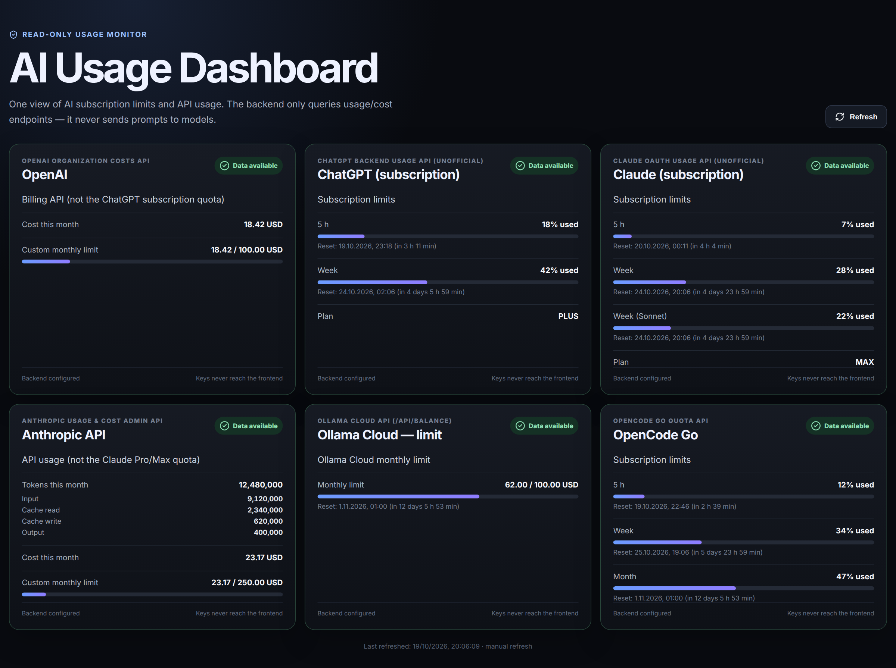

# AI Usage Dashboard — Go + React

[](https://github.com/daropotter/ai-usage-dashboard/actions/workflows/ci.yml)

Read-only dashboard of usage and limits for **OpenRouter**, **OpenAI**, **ChatGPT (subscription)**,
**Claude / Anthropic** (Pro/Max subscription and API usage), **OpenCode Go** and
**Ollama Cloud**.



*Screenshot with sample data.*

## Requirements

- Go 1.23+ (backend)
- Node 22+ and npm (frontend build)
- Docker with Compose (optional, for the container image)

## Tiles

Tiles are **configured on the backend through ENV**. The frontend has no list of
providers: it renders whatever `/api/dashboard` returns, in that order.

```env
TILES=claude,opencode   # ids, in display order

TILE_CLAUDE_TYPE=claude
TILE_CLAUDE_AUTH_FILE=/secrets/claude-credentials.json

TILE_OPENCODE_TYPE=opencode-go
TILE_OPENCODE_API_KEY=...
```

Each tile reads `TILE_<ID>_*`, where `<ID>` is the tile id upper-cased with
`-` → `_`. `TYPE` is required. `NAME` is optional (each type has a default).
The tile id is also its `id` in the API. Several tiles can use the same type,
for example two accounts of one provider. `.env.example` sets up one tile
of every type.

### Tile types

| `TYPE` | Data source | Keys (`TILE_<ID>_…`) |
| --- | --- | --- |
| `openrouter` | OpenRouter billing metadata: `GET /api/v1/key` for this key's daily/weekly/monthly/all-time cost, optional budget and free-model daily request limits; `GET /api/v1/credits` for account credits remaining, purchased and spent. Account credits may require a management key; if unavailable, the tile still shows key usage. Key labels are never returned to the frontend. | `API_KEY`, `URL`?, `CREDITS_URL`? |
| `openai-costs` | OpenAI Organization Costs API (`GET /v1/organization/costs`): organization cost this month. **Not** a ChatGPT subscription meter. Needs an organization admin key. | `API_KEY`, `MONTHLY_LIMIT_USD`? (local budget bar), `URL`? |
| `chatgpt` | 5 h / weekly subscription limits from the unofficial ChatGPT backend (`chatgpt.com/backend-api/wham/usage`), the same one Codex CLI uses. | `AUTH_FILE` (Codex CLI `auth.json`), `URL`?, `TOKEN_URL`? |
| `claude` | Pro/Max limits: 5 h / weekly and weekly per model, from the unofficial `api.anthropic.com/api/oauth/usage` (same as `/usage` in Claude Code). That endpoint is rate-limited per token: a successful result is reused for 5 minutes, and after HTTP 429 it is not called again until `Retry-After` or a backoff of 5 min doubling up to 1 h. | `AUTH_FILE` (Claude Code `.credentials.json`), `URL`?, `TOKEN_URL`?, `CACHE_SECONDS`? (default 300) |
| `anthropic-api` | Anthropic API (pay-as-you-go) usage this month from the Usage & Cost Admin API: tokens from `GET /v1/organizations/usage_report/messages` (input, cache read, cache write, output) and cost from `GET /v1/organizations/cost_report`. **Not** the Pro/Max quota (that is `claude`). Needs an organization Admin API key (`sk-ant-admin...`). | `API_KEY`, `MONTHLY_LIMIT_USD`? (local budget bar), `USAGE_URL`?, `COST_URL`? |
| `ollama-usage` | `GET https://ollama.com/api/usage`: `totals` (requests, USD, tokens) and `buckets`. The older `limits.session\|weekly\|monthly` format is still recognised. | `API_KEY`, `RANGE`? (`24h`\|`7d`\|`30d`), `MONTHLY_LIMIT_USD`?, `RESET_ANCHOR`? (older format only), `URL`? |
| `ollama-balance` | `GET https://ollama.com/api/balance`: monthly allowance, remaining credits, purchased credits and the **reset date** (`period.until`). The bar shows `(allowance - balance)/allowance`. It also queries `GET /api/usage?group_by=model` (last 7 days by default) and lists the most frequently used models under the monthly limit, with requests and cost (or tokens when cost is unavailable). | `API_KEY`, `RANGE`? (`24h`\|`7d`\|`30d`), `URL`?, `USAGE_URL`? |
| `opencode-go` | 5 h / weekly / monthly quota from `GET https://opencode.ai/zen/go/v1/usage`. | `API_KEY`, `URL`? |

`?` = optional. `URL` / `TOKEN_URL` / `USAGE_URL` / `COST_URL` / `CREDITS_URL` override the endpoints (for tests or a proxy).

**Unofficial endpoints:** the `chatgpt` and `claude` tiles use undocumented
consumer endpoints. They may change without notice or rate-limit requests; the
tile then shows `No data` / `Fetch error` with the upstream message.

A tile with a missing key shows `No data`, and its message names the exact
variable to set. A tile with an unknown `TYPE` shows `Fetch error`. If `TILES`
is empty, the dashboard says that no tiles are configured.

## Security assumptions

- Keys and tokens are read only by the backend (from ENV or mounted files);
  the frontend never receives keys or fragments of them.
- The application **does not call generation/chat/completions endpoints** and
  sends no prompts, so refreshing the dashboard does not consume model tokens.
- Every configured tile always exists. A missing key, an incompatible API or missing
  metrics yields the `No data` / `Fetch error` state without hiding the tile.
- `/api/dashboard` responses carry `Cache-Control: no-store`.
- The frontend refreshes data **manually only** (the "Refresh" button) — there is
  no automatic background polling.
- ChatGPT/Claude token auto-refresh writes the rotated tokens back to the
  mounted file (kept out of git). Note: the same `refresh_token` used
  concurrently locally and on a server invalidates each other.

## Running with Docker

```bash
cp .env.example .env
# put the keys you need into .env

docker compose up --build
```

Dashboard: `http://localhost:8080`

The ChatGPT and Claude tiles additionally require mounting the credentials files
(`TILE_<ID>_AUTH_FILE`) — see Tiles. For example, add to `docker-compose.yml`:

```yaml
services:
  dashboard:
    volumes:
      - ./auth.json:/secrets/chatgpt-auth.json
      - ./claude-credentials.json:/secrets/claude-credentials.json
```

The files must be writable: the backend writes rotated tokens back to them.

## Development

Terminal 1:

```bash
cd backend
set -a
source ../.env
set +a
go run .
```

Terminal 2:

```bash
cd frontend
npm install
npm run dev
```

The Vite proxy forwards `/api/*` to `localhost:8080`.

## Dashboard API

`GET /api/health` returns `{"ok": true}`.

`GET /api/dashboard`

Example shape (`id` is the tile id from `TILES`; metrics may have optional `resetAt` and `rows`):

```json
{
  "providers": [
    {
      "id": "openrouter",
      "name": "OpenRouter",
      "status": "ok",
      "configured": true,
      "summary": "Account balance and API key usage",
      "source": "OpenRouter billing API",
      "metrics": [
        {"label":"Credits remaining","value":"60.00 USD","rows":[
          {"label":"Purchased (all time)","value":"100.00 USD"},
          {"label":"Spent (all time)","value":"40.00 USD"}
        ]},
        {"label":"Cost this month (API key)","value":"12.00 USD","rows":[
          {"label":"Today","value":"1.00 USD"},
          {"label":"This week","value":"4.00 USD"},
          {"label":"All time","value":"25.00 USD"}
        ]},
        {"label":"API key budget (monthly)","value":"12.00 / 20.00 USD used","percent":60},
        {"label":"Free model requests today","value":"30 / 1,000","percent":3}
      ]
    },
    {
      "id": "opencode",
      "name": "OpenCode Go",
      "status": "ok",
      "configured": true,
      "summary": "Subscription limits",
      "source": "OpenCode Go quota API",
      "metrics": [
        {"label":"5 h","value":"12% used","percent":12,"resetAt":"2026-09-28T15:00:00Z"}
      ]
    },
    {
      "id": "ollama",
      "name": "Ollama Cloud",
      "status": "ok",
      "configured": true,
      "summary": "Ollama Cloud usage",
      "source": "Ollama Cloud API (/api/usage)",
      "metrics": [
        {"label":"Requests (7 days)","value":"7,035"},
        {"label":"Cost (7 days)","value":"12.44 USD"},
        {"label":"Tokens (7 days)","value":"4,180,000","rows":[
          {"label":"Input","value":"3,900,000"},
          {"label":"Cached","value":"1,200,000"},
          {"label":"Output","value":"280,000"}
        ]}
      ]
    },
    {
      "id": "ollama-balance",
      "name": "Ollama Cloud — limit",
      "status": "ok",
      "configured": true,
      "summary": "Ollama Cloud monthly limit",
      "source": "Ollama Cloud API (/api/balance)",
      "metrics": [
        {"label":"Monthly limit","value":"45.00 / 60.00 USD","percent":75,"resetAt":"2026-01-01T00:00:00Z"},
        {"label":"Top models (7 days)","value":"7,035","rows":[
          {"label":"glm-5.3-flash","value":"5,120 req · 9.42 USD"},
          {"label":"gpt-oss:120b","value":"1,215 req · 2.14 USD"},
          {"label":"qwen3-coder:480b","value":"700 req · 0.88 USD"}
        ]}
      ]
    }
  ]
}
```

`status`: `ok` | `no_data` | `error`.

## ENV

| Variable | Purpose |
| --- | --- |
| `PORT` | backend port (default 8080) |
| `TILES` | comma-separated tile ids, in display order |
| `TILE_<ID>_*` | per-tile settings (see Tiles) |

See `.env.example`. Never commit `.env` or credentials files to the repo.

## License

MIT — see [LICENSE](LICENSE).
